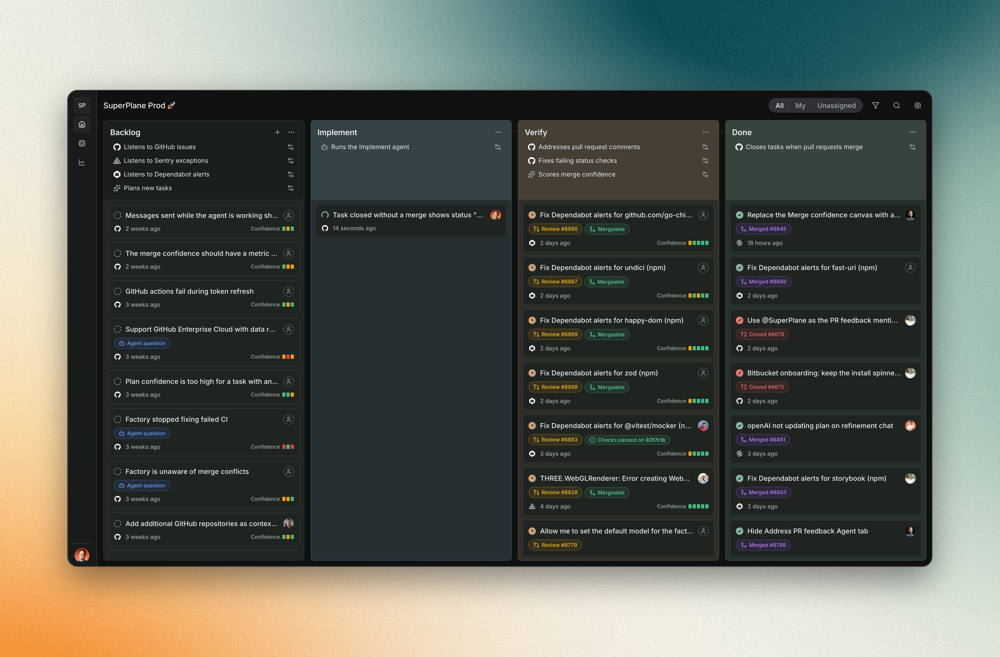
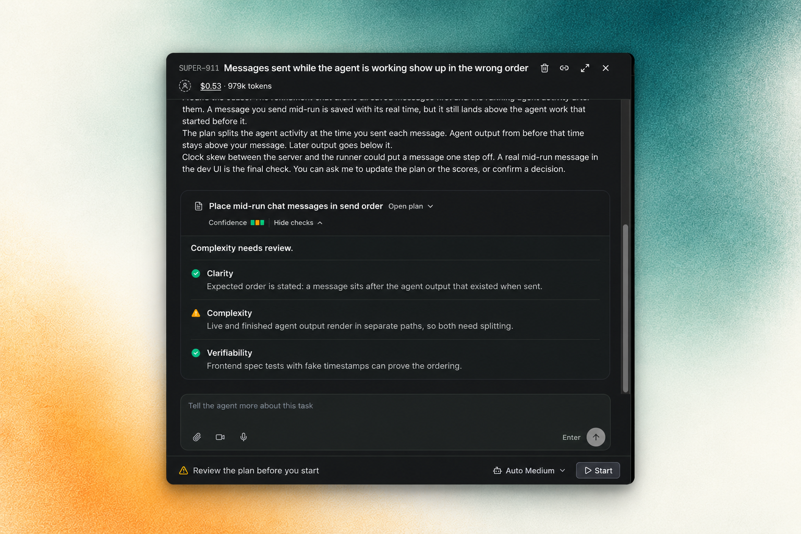
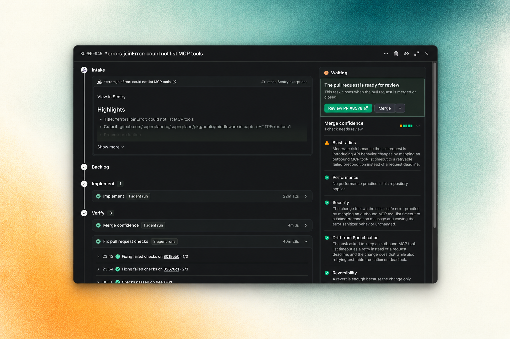

  

  
  
  
  

  <a href="https://app.superplane.com/">Try SuperPlane</a> ·
  <a href="https://superplane.com/">Website</a> ·
  <a href="https://docs.superplane.com/">Docs</a> ·
  <a href="https://docs.superplane.com/self-hosting/overview/">Self-host</a> ·
  <a href="https://discord.superplane.com/">Discord</a>

## About

**Open source factory for one-shot engineering.**

SuperPlane turns high-confidence backlog issues into verified, review-ready
pull requests so engineers can focus on work that needs judgment.

SuperPlane lets AI agents fully automate routine development work. It
coordinates coding agents, source control, CI, review, approvals and feedback
in one visible system so engineers do not have to project-manage every step.

The factory continuously evaluates which backlog issues agents can handle with
high confidence. It applies the same workflow-level guardrails to every run,
checks the result and sends failures back to the agent with actionable context.
Ambiguous work and decisions that need human judgment stay with your team.

SuperPlane is built on an Apache 2.0 open source engine. Choose your models,
run in the cloud or on-prem and build the factory around your stack and cost
constraints.

## How it works

### Turn backlog issues into work agents can deliver

  

Reliable automation starts with a clear task. SuperPlane analyzes the issue,
helps refine the plan, and identifies decisions that need your input before
implementation begins.

### Bring verified changes to human review

  

SuperPlane checks the agent's work and sends failures back for correction.
An agent review assesses merge confidence and highlights remaining concerns,
so your team can make the final decision with evidence.

The plan and the pull request review are two parts of that workflow. SuperPlane
can also wait for an event from your tools, call an agent, or ask a person for
approval.

## Getting started

### SuperPlane Cloud

1. [Sign up](https://app.superplane.com/) and create a workspace.
2. Connect a GitHub repository.
3. Choose a small bug, a test fix, or a documentation update for the first run.

SuperPlane imports the issues and assesses which tasks are suitable for an agent.

- Follow the [quickstart](https://docs.superplane.com/get-started/quickstart/) for setup.
- Read the [product overview](https://docs.superplane.com/get-started/overview/) to learn how SuperPlane coordinates agents and verification.

### Self-host

Install SuperPlane on your own infrastructure.

- Use Docker Compose on one Linux VM.
- Use Kubernetes on AWS, Azure, or Google Cloud.

See the [self-hosting guide](https://docs.superplane.com/self-hosting/overview/).

## Contributing

We welcome focused pull requests, bug reports and product ideas.

1. Read the [contributing guide](./CONTRIBUTING.md).
2. Review the [issue tracking process](./docs/contributing/issue-tracking.md).
3. Find an [open issue](https://github.com/superplanehq/superplane/issues).
4. Join the [Discord community](https://discord.superplane.com) to discuss an
   approach with maintainers.

Contributor setup is Docker-based. Start with the repository instructions in
[`AGENTS.md`](./AGENTS.md) and the development section of
[`CONTRIBUTING.md`](./CONTRIBUTING.md).

## Community and license

- [Discord](https://discord.superplane.com) for discussions and support
- [Blog](https://superplane.com/blog/) for engineering notes and releases
- [Community events](https://luma.com/superplane) for maintainer sessions
- [X](https://x.com/superplanehq) for product updates

SuperPlane is available under the [Apache License 2.0](./LICENSE).
