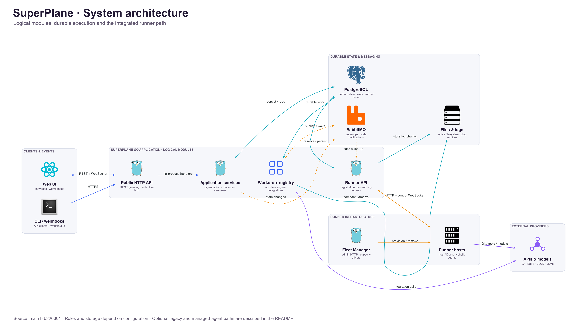
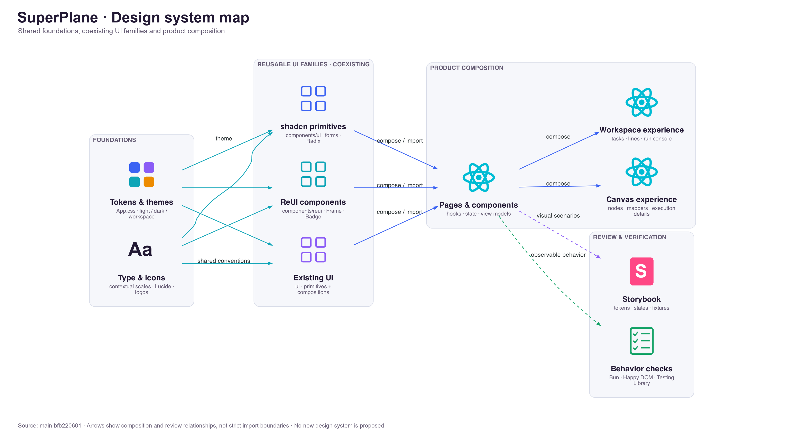

# SuperPlane architecture and design system

Start here for a visual map of the runtime and the React interface.
The diagrams show logical responsibilities and the integrated runner path.
Deployment roles, storage providers, and optional execution paths depend on configuration.

## System architecture

Select the image to view it at full resolution.

### From a request to an execution

1. The web UI and CLI call the public HTTP API. Provider webhooks enter their dedicated HTTP routes.
2. The REST gateway calls generated Go handlers and application services in the same process.
3. Services persist domain changes and execution work in PostgreSQL. Factory line dispatch creates canvas runs for the selected app versions.
4. Workers route events, admit queued work, execute registered components, and finalize runs. RabbitMQ notifications and database scans drive this work.
5. Components call integration APIs or create runner tasks. The Runner API reserves integrated runner tasks from PostgreSQL and delivers control messages.
6. Runners execute shell commands and agent tools. Results update durable state, and the browser receives state notifications and reads execution logs.

Factory workspaces organize tasks, lines, and apps.
A canvas is a versioned graph with nodes and edges.
Factory line execution uses the canvas engine; it does not introduce a second workflow engine.

### Boundaries that matter

| Boundary | Responsibility | Source |
| --- | --- | --- |
| HTTP and application services | REST handlers, organization authentication and authorization, webhooks, and browser connections. The gateway dispatches to Go services in process. | [Public server](../../pkg/public/server.go), [service assembly](../../pkg/grpc/services.go), [gateway authorization](../../pkg/grpc/gateway_authorization_middleware.go) |
| Workflow engine | Durable events, queue admission, component execution, scheduled requests, and finalization. Workers use notifications and periodic database scans. | [Worker startup](../../pkg/server/server.go), [event router](../../pkg/workers/event_router.go), [node queue](../../pkg/workers/node_queue_worker.go), [registry](../../pkg/registry/registry.go) |
| Domain and work state | PostgreSQL stores organizations, canvases, factory tasks, execution records, runner tasks, and log metadata. | [Models](../../pkg/models), [factory dispatch](../../pkg/models/factory_work_order_line_dispatch.go), [canvas versions](../../pkg/models/canvas_version.go) |
| Notifications | RabbitMQ carries work wake-ups and state notifications. The event distributor forwards relevant notifications to browser WebSocket connections. | [Event distributor](../../pkg/workers/event_distributer.go), [runner notifications](../../pkg/runners/control/notifications.go) |
| Runner execution | Runner registration, control WebSocket, task reservation, and HTTP log uploads. Runners communicate through this API. | [Runner API](../../pkg/public/runnerapi/server.go), [runner agent](../../pkg/runners/agent/agent.go), [runner task creation](../../pkg/workers/contexts/runner_task_context.go) |
| Fleet capacity | A separate Fleet Manager uses the installation-admin HTTP API. Its providers manage runner infrastructure on AWS, Azure, GCP, or Docker. | [Fleet Manager entry point](../../cmd/fleetmanager/main.go), [reconciler](../../pkg/fleets/reconcile/reconciler.go) |
| Files and logs | Active runner log chunks use a filesystem store. A compactor writes archived logs to blob storage and records their metadata. | [Log storage design](../design/active-runner-task-log-storage.md), [log compactor](../../pkg/workers/runner_task_log_compactor.go), [log reads](../../pkg/public/runner_task_logs.go) |

RabbitMQ messages announce work; PostgreSQL holds the durable queue and execution records.
Some workers, including scheduled request workers, use database polling directly.
The diagram groups related responsibilities and omits individual worker types and recovery loops.

The application modules can share one Go process or run as configured roles.
The Runner API can share the public HTTP server or run separately.
Runners and Fleet Manager use their API boundaries to access application state.

Files and archived logs use the configured blob provider: filesystem, S3, GCS, or Azure.
Browser state updates use WebSocket connections.
Runner command logs use separate HTTP/NDJSON routes, with signed downloads or proxy reads for archives where supported.

Authentication depends on the route.
Organization API routes enforce their authentication and permission checks.
Public views, provider callbacks, and runner routes have their own access rules.

### Optional execution paths

The main diagram follows the integrated runner implementation.
[Runner backend selection](../../pkg/components/runner/task_client.go) uses the organization's `new_runners` feature to choose integrated runners or the legacy task broker.
Existing tasks retain their selected backend.

[Managed-agent configuration](../../pkg/server/server.go) also enables a separate provider path for supported agent sessions.
The diagram does not require every agent session to run on a provisioned runner host.

For more detail, see the [architecture guide](../contributing/architecture.md), [factory design](../design/factory.md), and [single-host deployment guide](../contributing/single-host-release.md).

## Design system and frontend composition

The interface combines shared foundations with several component families.
The arrows show composition and review relationships; imports can cross these groups.
Use this map to find existing components before adding a new pattern.

| Layer | Where to look | What to reuse |
| --- | --- | --- |
| Tokens and themes | [App.css](../../web_src/src/App.css), [ThemeProvider](../../web_src/src/contexts/ThemeProvider.tsx) | Semantic colors, borders, radii, and light/dark preferences. Workspace styles also override tokens through `.theme-factories`. |
| Typography and icons | [Global styles](../../web_src/src/index.css), [Icon](../../web_src/src/components/Icon), [icon registry](../../web_src/src/lib/iconRegistry.ts) | Existing context-specific typography and Lucide icons. Integration logos have their own assets and theme helpers. |
| shadcn primitives | [components/ui](../../web_src/src/components/ui) | Shared form controls and interaction primitives, commonly built with Radix, Tailwind, and class variants. These are the preferred form controls. |
| ReUI components | [components/reui](../../web_src/src/components/reui) | Existing compositions such as Frame and Badge. Implementations vary; some use Base UI. |
| Existing UI | [ui](../../web_src/src/ui) | Both reusable primitives and larger compositions, including ComponentBase, CanvasPage, and Runs. This directory remains part of the application. |
| Product composition | [Factory pages](../../web_src/src/pages/factories), [app pages](../../web_src/src/pages/app), [integration mappers](../../web_src/src/pages/app/mappers) | Pages combine component families, hooks, state, and view models. Mappers adapt integration data for canvas components and execution details. |
| Visual review | [Storybook setup](../../web_src/.storybook), [design token stories](../../web_src/src/pages/factories/DesignTokens.stories.tsx) | Component states, theme examples, and fixtures. The token catalog is **Factories → Design System → Tokens**. |
| Behavior checks | [Bun test setup](../../web_src/src/test/bun-preload.ts), [Make targets](../../Makefile) | Tests for observable behavior, accessibility, state changes, and regressions. Stories and automated checks cover different concerns. |

Start with the [frontend component guide](../../web_src/AGENTS.md) and inspect a nearby implementation.
Use existing semantic tokens and shared controls for new UI.
Match the relevant surface's typography, spacing, empty states, error states, and keyboard behavior.
Some component families contain distinct implementations of the same primitive; verify the import path before reuse.

Storybook loads the application styles, theme context, and query setup.
Stories with mock handlers supply simulated API responses.
The catalog is a review tool; it does not imply that every component has automated visual coverage.

For canvas components and integration output, see the [component design guide](../contributing/component-design.md).

## API contracts and browser data

Protocol buffers define API messages, services, and HTTP mappings in [protos](../../protos).
`make pb.gen` generates Go gateway code and the OpenAPI specification.
[The frontend generator](../../web_src/openapi-ts.config.ts) creates the TypeScript client under `web_src/src/api-client`.
Generated paths are ignored by Git and must not be edited manually.

React hooks use that client with TanStack Query and organization context.
WebSocket handlers update or invalidate cached application state.
Runner log readers use the separate HTTP/NDJSON stream described above.

## Diagram scope and maintenance

The diagrams were checked against [main at bfb220601](https://github.com/superplanehq/superplane/commit/bfb220601dae150e1f635a840ac597c0d6ad669d).
They describe the source architecture at that revision, including configurable paths.
Use the linked code and guides when changing a boundary or component family.
Keep the images and this explanation consistent when those responsibilities change.
