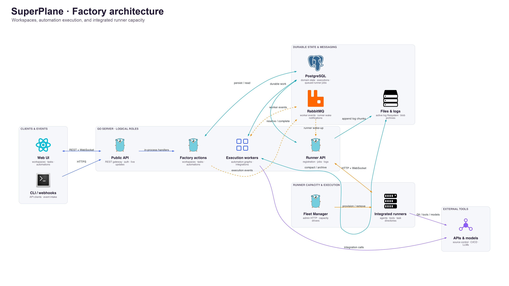

# Architecture Overview

SuperPlane coordinates software work in organization-scoped workspaces. This
guide connects the product concepts to the code used to plan, run, and review
tasks.

## Product model

| Concept                   | Role                                                                    |
| ------------------------- | ----------------------------------------------------------------------- |
| Organization              | Owns workspaces, members, and integrations.                             |
| Workspace (`Factory`)     | Groups tasks, automations, and workspace settings.                      |
| Task (`FactoryWorkOrder`) | Tracks a unit of software work through planning and execution.          |
| Automation                | A versioned execution graph of triggers and components.                 |
| Runner job (`RunnerTask`) | One execution job for a runner. A product task can create several jobs. |

## Runtime components

The Go server provides API handlers, execution workers, and the Runner API.
A deployment can run these roles together or in separate server processes.
The React UI uses REST for requests and WebSocket for updates. Protocol Buffers
define the API contracts; the REST gateway calls application actions in process.

PostgreSQL stores domain objects, execution records, and queued runner jobs.
RabbitMQ carries worker events and runner-control notifications. Integrated
runners receive work through the Runner API over HTTP and WebSocket.
Active runner logs use filesystem storage; workers compact them into blob archives.

Fleet Manager reads capacity through the installation admin API and provisions
or removes runners.

[Diagram source and render instructions](https://github.com/velrino/superplane/tree/92159774f9343c779d759471da8aaa3731ca27d6/source).

## From task to execution

1. A user or intake integration creates a task in a workspace. Dispatch starts
   or queues a configured automation step.
2. The server pins the run to the live automation version and records its
   execution. Workers initialize the graph, route events, and invoke components.
3. Components can call external APIs or queue a `RunnerTask` for an integrated
   runner. A connected runner reserves a job from its fleet through the Runner API.
4. For runner jobs, the runner uploads logs and reports completion. Workers resume
   the graph and update the task execution. After an automation finishes, the next
   configured step can start.

Local development uses the integrated runner stack. The retired task broker is
retained for historical logs.

## Find the code

| Location                                                                                                               | Purpose                                                    |
| ---------------------------------------------------------------------------------------------------------------------- | ---------------------------------------------------------- |
| [cmd/server](../../cmd/server), [cmd/cli](../../cmd/cli)                                                               | Server and CLI entrypoints.                                |
| [web_src/src/pages/factories](../../web_src/src/pages/factories), [web_src/src/pages/app](../../web_src/src/pages/app) | Workspace UI and automation editor.                        |
| [pkg/public](../../pkg/public), [pkg/grpc/actions/factories](../../pkg/grpc/actions/factories)                         | HTTP gateway, webhooks, and Factory actions.               |
| [pkg/models](../../pkg/models)                                                                                         | Persistent domain objects and transactional state changes. |
| [pkg/workers](../../pkg/workers), [pkg/components](../../pkg/components)                                               | Graph scheduling and built-in components.                  |
| [pkg/integrations](../../pkg/integrations)                                                                             | External tool integrations.                                |
| [cmd/runner](../../cmd/runner), [pkg/runners](../../pkg/runners)                                                       | Runner executable and execution engines.                   |
| [pkg/public/runnerapi](../../pkg/public/runnerapi)                                                                     | Runner registration, job delivery, logs, and completion.   |
| [cmd/fleetmanager](../../cmd/fleetmanager), [pkg/fleets](../../pkg/fleets)                                             | Fleet Manager executable and capacity reconciliation.      |
| [protos](../../protos), [db](../../db)                                                                                 | API contracts, database schema, and migrations.            |

The generated UI client is `web_src/src/api-client/`. Run `make pb.gen` to
regenerate API clients after changing protos. Generated clients are ignored by Git.

See [CONTRIBUTING.md](../../CONTRIBUTING.md) for local setup and
[model guidelines](../../pkg/models/AGENTS.md) for database changes.
