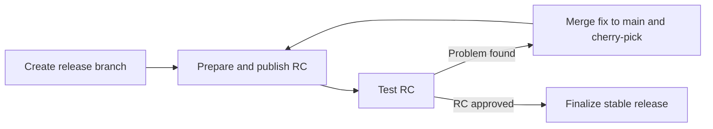

# Single-host release

Every SuperPlane release includes `superplane-single-host.tar.gz`. The archive
installs SuperPlane on one VM with Docker Compose.

`release/superplane/build-assets.sh` resolves the latest stable Runner and
Fleet Manager tags before it builds the archive. It writes those tags into
`release/superplane-helm-chart/helm/values.yaml`. If GitHub is unreachable,
the committed values stay in place. The Helm chart in that same release uses
those tags. It does not call GitHub again. A standalone chart build still
resolves the latest stable tags.

`release/superplane-single-host-tarball/build.sh` reads `runnerVersion` and
`fleetManagerVersion` from that file and writes them into the Compose file
and `install.sh`.

The archive contains:

- `docker-compose.yml` for the app, Fleet Manager, Postgres, RabbitMQ, and Caddy
- `install.sh`, which keeps existing secrets when you run it again
- `uninstall.sh`, which removes this installation and preserves data by default
- `Caddyfile` for automatic HTTPS

The installer starts Fleet Manager automatically. Set
`SUPERPLANE_RUNNER_MAX_CAPACITY` and `SUPERPLANE_RUNNER_WARM_CAPACITY` when
you run `install.sh` to change the default capacities of five and one.

Fleet Manager and the runner image are separate release artifacts:

- `ghcr.io/superplanehq/fleet-manager:<version>-docker` includes the Docker CLI
- `ghcr.io/superplanehq/runner:<version>` is the tool image for runner containers

The release pipeline publishes the archive. It does not boot it. Boot the
archive on a machine before you rely on a new release.

## Release SuperPlane

SuperPlane releases use a versioned branch, such as `release/v1.0.x`. The
release commit must have successful CI.



### Publish a release candidate

1. Merge all release changes into `main`.
2. Create the release branch from `main`.

   ```bash
   git switch main
   git pull --ff-only
   git switch -c release/v1.0.x
   git push -u origin release/v1.0.x
   ```

3. Wait for the release branch pipeline to pass.
4. Select `Prepare SuperPlane Release`.
5. Set `RELEASE_VERSION` to the next candidate, such as `v1.0.0-rc8`.
6. Start the promotion and wait for it to finish.
7. Select `Publish SuperPlane Release`.
8. Wait for the publication to finish.
9. Test the published release candidate.

If you find a problem:

1. Merge the fix into `main`.
2. Cherry-pick the fix into the release branch.
3. Push the release branch and wait for CI.
4. Prepare and publish the next candidate, such as `v1.0.0-rc9`.

### Publish the stable release

1. Open the completed `Publish SuperPlane Release` pipeline for the approved
   candidate.
2. Select `Finalize SuperPlane Release`.
3. Confirm `RELEASE_CANDIDATE_VERSION`, such as `v1.0.0-rc8`.
4. Set `RELEASE_VERSION` to the matching stable version, such as `v1.0.0`.
5. Start the promotion and wait for it to finish.
6. Select `Publish SuperPlane Release`.
7. Wait for the stable publication to finish.

The stable version must match the candidate version core. For example,
`v1.0.0-rc8` can only become `v1.0.0`.

Finalization uses the candidate Git commit and component versions. It stops if
the candidate artifacts are missing or modified.

To test the archive without starting containers:

```bash
bash release/superplane-single-host-tarball/test.sh
```

To boot a local install from an image you already built:

```bash
bash release/superplane-single-host-tarball/build.sh v9.9.9
bash release/superplane-single-host-tarball/smoke-test.sh \
  build/superplane-single-host-tarball-v9.9.9/superplane-single-host.tar.gz \
  ghcr.io/superplanehq/superplane:v9.9.9
```

Set `SUPERPLANE_SMOKE_KEEP=yes` to keep that install running.

## Remove the installation

Run `uninstall.sh` from the installation directory. It removes the verified
Compose services, managed runners, and project network. It preserves named
volumes, configuration, and OIDC keys by default.

Stop new work and wait for tasks to finish. Use `--force` to permit interruption
of running runners. Use `--yes` to skip confirmation. These flags do not delete
volumes.

When preserving data, the script retires runners through the application API
before removal. If retirement fails, run `install.sh` to resume before retrying.

Use `--purge` to delete verified project volumes after you back up the data.
Host configuration and OIDC keys remain. After a preserving removal, run
`install.sh` before a later purge so the script can verify resource ownership.

The public [maintenance guide](https://docs.superplane.com/self-hosting/upgrade-and-uninstall/)
contains the operator procedures. Do not use a global Docker prune command.
