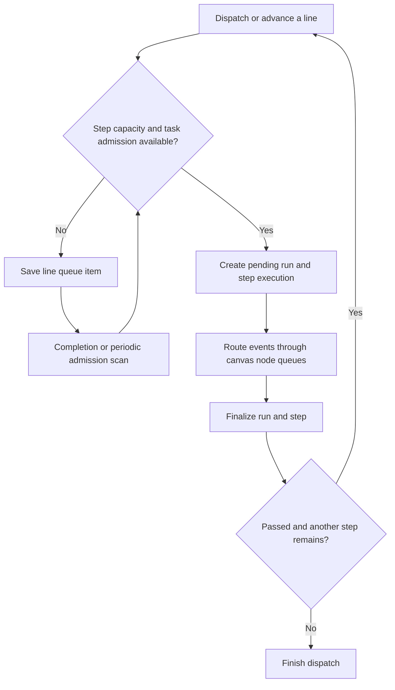

# Task queue and admission

This document describes the queue implementation in the repository as of
October 23, 2026. It covers Factory tasks, line steps, and canvas node queues.
Use it with the [Factory design](factory.md) when changing task execution.

SuperPlane saves waiting work in PostgreSQL. Admission decides when that work
can start. The organization limit counts distinct tasks across all factories
in the organization. Each line step also has a separate execution limit.
RabbitMQ messages notify workers about changes. Database scans provide recovery
when a notification does not arrive.

## Summary

1. A task requests analysis or starts a line.
2. SuperPlane locks admission for the organization and checks task and step capacity.
3. Eligible work starts. Other work stays in PostgreSQL until capacity becomes available.
4. Workers create component executions from canvas node queues.
5. Completion releases capacity. Notifications and periodic scans start the next eligible work.

For example, an organization with a limit of two can run tasks A and B.
Task C waits even when its line has spare capacity.
More work for task A can share its existing slot, subject to local limits.
When A finishes all its work, C can start if no older eligible task waits.

## Queue layers

| Layer | Waiting work | Capacity scope |
| --- | --- | --- |
| Organization task admission | Line queue items and pending task root events | Distinct active work orders across the organization |
| Line step admission | One pending step per line dispatch | Pending and running step executions, plus runs still stopping, at the same line and step index |
| Canvas node queue | Events routed to a component | Active executions at the same canvas, node, and resolved queue key |
| RabbitMQ | Change notifications for workers and clients | Message delivery; the database holds task admission state |

A task is a work order. A line dispatch is one traversal through a line.
A step execution links that traversal to a canvas run.
An active dispatch can wait without an active execution.
Therefore, an active dispatch alone does not consume an organization slot.

Runner availability is a later constraint. Task admission does not reserve a
runner or guarantee that a component starts immediately.

## Organization capacity

The effective billing plan supplies `parallel_task_limit`. Plan resolution
includes trial and subscription expiry. A null limit means unlimited capacity.
When billing is disabled, the organization limit is unlimited. Line and node
limits still apply.

Capacity counts distinct work order IDs, including work identified through:

- Pending or running line step executions.
- Active analysis runs attached to planning sessions.
- Active pull request automation runs attached to the task.
- Routed task root events with node queue items or node executions.
- Active descendant runs whose ancestors belong to the task.

Active canvas runs include `pending`, `started`, and `cancelling` states.
Descendants retain the task identity after their parent run finishes.
Several runs for one task consume one organization slot.
An unadmitted root event does not reserve a slot.

An already active task can admit more work without another organization slot.
That work still obeys its line step limit.
Waiting for a node, an approval, or cancellation can keep the task active.
The slot becomes available when no qualifying active work remains.

A plan change affects later admission decisions. A lower limit does not cancel
existing work. New tasks wait while the active count reaches or exceeds the
new limit.

## Admission and ordering

SuperPlane combines line queue items and pending task root events into an
organization queue. It orders entries by creation time, then by entry ID.
The ID provides a stable order when creation times match.

Admission follows these rules:

1. For a line step, check its local execution limit.
2. If the task already has active work, allow it to share that organization slot.
3. Otherwise, check the effective organization limit.
4. Find the oldest eligible entry in the organization queue.
5. Admit new work only if that entry belongs to the same task, or no eligible entry exists.

A locally full line step is not eligible. The scheduler skips it when another
task can use an available organization slot.
Older eligible work prevents a new task from bypassing the queue.
Already active tasks bypass the organization ordering check because they
already hold a slot.

The displayed position counts distinct tasks in the full queue, including
locally blocked entries. Multiple entries for one task share its position,
based on its oldest entry. Positions span all factories in the organization.
A filtered board can therefore show gaps in position numbers.

A position is not a start-time estimate or an unconditional execution order.
For example, task A can show `Queued #1` while its line step is full.
Task B can show `Queued #2` and start first if its step has capacity.

There are two position fields:

| Field | Meaning |
| --- | --- |
| `queued_tasks[].position` | Organization position among distinct waiting tasks |
| `line_dispatches[].queue_item.position` | Position among entries for that line and step |

## Line step lifecycle

A dispatch saves a snapshot of the line name and steps.
Each step has `max_parallelism`, with a default of 10.
There is no unlimited line step setting.
The limit counts pending and running executions across all work orders on that
line at that step index. A finished execution also retains its reservation
while its run is unfinished.

The live line supplies the current limit at the same step index.
If the live line no longer has that index, admission uses the dispatch snapshot.
The snapshot still selects which app and entrypoint run next.
`StartStep` selects the app's live canvas version when it creates the run.

When both admission checks pass, SuperPlane creates a pending canvas run and
a pending step execution. Otherwise, it creates a
`factory_work_order_queue_items` row and records `step.execution.queued`.
No run or execution exists yet for that waiting step.
A dispatch can have at most one line queue item.



Admission deletes the queue item and creates the run and execution in one
transaction. It also opens a draft task when its line work starts.
A queued initial dispatch remains `draft` in Backlog. The dispatch request
can assign its owner before execution starts.

After a step passes, the finalizer attempts the next step through the same
admission checks. A failed or cancelled step ends the traversal.
If the work order closes, the finalizer does not start another step.
Completion also attempts to admit other queued line work in the organization.

## Analysis and other task automations

Task automations can start through root events without a line dispatch.
The event router applies the same organization admission check before it
creates downstream node queue items.

The check applies to a Factory canvas whose event identifies an existing work
order in that factory. It recognizes `workOrder.id` and `work_order.id` in
the event payload. Events without this task association bypass this check.
The organization limit is therefore a task limit, not a limit on all canvases.

If capacity or ordering prevents admission, the routing transaction rolls back.
The root event remains `pending`. Analysis session attachment also waits until
admission succeeds. A pre-existing canvas run does not by itself mean that
task execution has started.

The organization queue exposes pending root events with an associated pending
or started run for a draft or open task. It excludes runs already represented
by a line step execution.
Once routing succeeds, the event leaves the pending queue and its downstream
work contributes to active task capacity.

## Product behavior and cancellation

Work order detail and list responses include `queued_tasks` and
`task_limit_reached`.
Field names below use protobuf notation. JSON uses camelCase.

| Field | Meaning |
| --- | --- |
| `queued_tasks[].id` | Identity of the specific pending line item or root event |
| `queued_tasks[].name` | Name of the pending automation |
| `queued_tasks[].starts_line` | The line dispatch has no step executions yet |
| `queued_tasks[].line_dispatch_id` | Dispatch identity for a queued line step |
| `queued_tasks[].task_active` | Other admitted work still holds this task's slot |
| `task_limit_reached` | This inactive task would exceed the organization limit |

`task_limit_reached` does not describe line capacity or older waiting tasks.
It is a UI hint. The backend checks current state again when a request arrives.

The workspace usage response includes `active_task_count` and optional
`parallel_task_limit`. The workspace header shows these organization totals
when the limit is present. The header refreshes capacity every 10 seconds.
An absent limit means unlimited organization capacity.

Task cards show `Queued #N` for waiting work. Queue status takes precedence
over the card's score or analysis indicator.
The task popup labels its start action **Queue** when the organization limit
is reached. It hides that action when an initial line start is already queued.
An open task with admitted work stays Running when additional work queues.

Interactive cards can expose **Remove from queue**. The task popup displays
queue status without a cancellation control.
The cancellation endpoint is:

```text
PATCH /api/v1/factories/{factory_id}/orders/{order_id}/queue/cancel
Body: { "queueId": "<pending-entry-id>" }
```

The endpoint requires an authenticated user and work order update permission.
Cancellation uses the exact pending entry ID under the organization lock:

- A line item is deleted. Its dispatch finishes as cancelled if no open work remains.
- An initial line cancellation returns the task to draft when it has no other active work.
- Cancelling a later queued step preserves the task's current lifecycle state.
- A queued root event uses the existing run cancellation process.
- An admitted, removed, or replaced entry returns `FailedPrecondition`.

A stale card cannot cancel replacement work or a run that already passed
admission. The user can refresh to get the current task state.
The cancellation response includes the updated work order.
The UI invalidates organization Factory queries because other queue positions
can also change.

## Transactions and recovery

Admission decisions use a PostgreSQL transaction advisory lock scoped to the
organization. Callers acquire it before row locks and writes.
Dispatch, root routing, finalization, replacement, and cancellation use this
order to keep capacity decisions consistent across server replicas.

The line admission path also locks the line row before its local capacity
decision. Queue deletion, task state changes, and run creation commit together.
Workers publish change notifications after commit.

Queued candidates use nested transactions with savepoints.
A missing entrypoint, missing live app version, or invalid step cannot leave a
partial run after admission fails.
The scanner removes unstartable line items and finishes their dispatch as
failed when no open work remains.
Stale items for inactive dispatches, missing factories, or non-dispatchable
tasks are removed through cancellation cleanup.
Database failures return an error so later scans can retry.

| Trigger | Behavior |
| --- | --- |
| Line step finalization | Attempts the next step and admits eligible line items in the organization |
| Dispatch replacement or step retry | Releases old step work and attempts queued line admission |
| Run finalizer admission scan | Every 5 seconds, scans organizations with line queue items; skips an organization whose lock is busy |
| Event router pending scan | Every minute, retries pending root events, including task events blocked by admission |
| Node queue recovery scan | Every minute, checks nodes with actionable waiting items |

These intervals are polling intervals, not latency guarantees.
Root-event work can wait for the minute scan after capacity becomes available.
An older pending root event can also keep a later line item waiting until
the router admits it.

Closing a work order removes its queued line items.
Queue removal does not imply that all already running work stops immediately.
Active descendant and cancelling runs can continue to hold the organization slot.
Replacement work waits for cancellation to finish, including cancelled descendant
runs. Spare organization capacity does not permit an overlapping replacement.
These waiting replacements do not block other eligible tasks.

### Analysis recovery

Analysis can stop before the event router attaches a planning session.
After queue removal, the task popup restores the chat and the analysis action.
The action shows **Analyze** when capacity is available and **Queue analysis**
when the organization limit is full. Both actions use the same queue as
implementation. A queued analysis shows its queue position instead of an
active analysis state.

The action sends a message through the work order endpoint when no session
exists:

```text
POST /api/v1/factories/{factory_id}/work-orders/{work_order_id}/planning-session/messages
Body: { "text": "Analyze this task." }
```

The server validates the task and its analysis run before it creates a session.
The request requires the same work order update permission as a session message.
An active analysis stays queued or running. A cancelled analysis can queue a
restart while its previous run stops. Recovery does not bypass organization
admission or reserve a slot.
The restarted analysis enters the root-event queue through the normal path.

## Diagnose waiting work

| Observation | Check |
| --- | --- |
| Organization capacity is full | Check all factories, including active analysis, approvals, descendants, and cancelling runs. |
| Capacity is available but a task waits | Check older eligible tasks and the line step limit. |
| A replacement waits after cancellation | Wait for the previous run and its descendants to stop. |
| A root event waits after capacity becomes available | Allow the event router's minute scan to retry admission. |
| A task started, but its component waits | Check the node queue limit and runner availability. |
| Queue cancellation returns `FailedPrecondition` | Refresh the task. The pending entry may have started or been replaced. |

## Canvas node queues

After task admission, the event router saves items in
`workflow_node_queue_items` for downstream nodes.
`NodeQueueWorker` consumes these database items and creates component executions.
It responds to queue-created and execution-finished notifications.

A node's `concurrency.max` defaults to 1.
Its optional `concurrency.key` partitions incoming work into independent queues.
Without a key, the node ID is the queue name.
A resolved name is saved on the queue item and execution.
Equal names on different nodes do not share capacity.

Capacity counts `pending`, `started`, and `cancelling` executions for the same
canvas, node, and resolved name.
The worker processes actionable items in creation order and checks up to 100
items per pass. Full queues do not block other queues on the node.

Components with their own queue processor, such as Merge and Loop, manage
their own admission. They bypass the default node capacity check.
An invalid queue expression produces a failed execution and removes the item.
A node in an error state retains waiting work until its configuration is fixed.

## Implementation references

- [Organization admission and locking](../../pkg/models/organization_task_admission.go)
- [Active task identity and descendant runs](../../pkg/models/organization_task_activity.go)
- [Combined queue, positions, and cancellation](../../pkg/models/organization_task_queue.go)
- [Line dispatch and step creation](../../pkg/models/factory_work_order_line_dispatch.go)
- [Line queue storage and local positions](../../pkg/models/factory_work_order_queue_item.go)
- [Periodic task admission](../../pkg/workers/organization_task_admission.go)
- [Root event admission](../../pkg/workers/event_router.go)
- [Step finalization](../../pkg/workers/run_finalizer.go)
- [Node queue processing](../../pkg/workers/node_queue_worker.go)
- [Work order serialization](../../pkg/grpc/actions/factories/work_order_serialization.go)
- [Queue API contract](../../protos/factories.proto)
- [Queue status on task cards](../../web_src/src/pages/factories/workOrders/WorkOrderQueueStatus.tsx)
