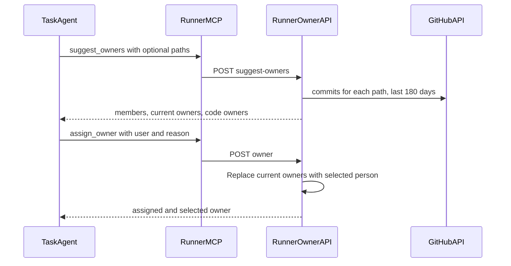

# Task owner tools for task agents

## Summary

Exceptions, production problems, and CVE security problems often arrive at
night. A task without an owner stays stale. Each team has its own rules for who
reviews and who owns a task.

Every supported agent gets two owner tools when its run has a validated task
association. One tool finds eligible owners. The other tool sets the task owner
through an explicit agent action. Teams supply assignment rules in their agent
instructions. Planning sessions keep their existing owner tools and instructions.

This includes Run Claude Code, Run Codex, Run OpenRouter Agent, and Run
SuperPlane Agent. Hosted providers and custom providers through OpenCode use
the same tools. Supported task associations include factory line runs, PR
discussion runs, visual verification, custom automations, and merge-confidence
runs. Visual evidence is not required.

## Goals

1. Let the agent find the best reviewer for the code that a change touches.
2. Let the agent see the members of the organization, their roles, and the
   number of open tasks that each member owns.
3. Let the agent set the task owner when the instructions ask for it.

## Non-goals

- Assign an owner when the instructions do not ask for it.
- Read rules from a repository file.
- Assign a fallback owner from the server.
- Send a new notification for the assignment.
- Change manual assignment controls, owner ranking, or team routing rules.
- Read Bitbucket code history.

## Example instructions

```text
When creating a plan, write down at the top of the plan which user is best
suited to review this task. Base it on the commit history of the files that
need to be changed. Write down their SuperPlane name and their GitHub account.
```

```text
Assign one owner while you plan this task. Always assign a person.

CVE security problems go to Mijat.
Sentry exceptions in payments go to Pedro.
A production problem in the web app goes to the person who last changed that
screen.

Everything else goes to the person with the fewest assigned tasks on the board.
```

## How it works



The planning protocol names the two tools. It tells the agent to use them only
when the task or the instructions ask for a reviewer or an owner.

## Tools

Planning tools use the planning session token. Other task agents use a dedicated
signed owner token. The runner derives the task from its validated run association.
Merge-confidence agents use the task from their validated merge scope.

The owner token binds the organization, factory, task, canvas, run, and node
execution. The server checks these associations on each request. Tool calls
cannot select a different task. Runs without a validated task receive no owner
token. Ownership alone does not enable artifacts, link publication, merge
reports, or planning publication.

### `suggest_owners`

Input: `paths`, optional, at most 10 repository paths.

Output:

| Field | Content |
| --- | --- |
| `paths` | The cleaned paths. Paths that leave the repository are removed. |
| `current_owners` | The owners of the task now. |
| `members` | Each human member: `user_id`, `name`, `email`, `github_login`, `roles`, and `open_tasks`. Sorted by `open_tasks`, fewest first. |
| `code_owners` | Members who changed the paths, ranked by recent commits. Empty without paths. |
| `history_note` | Set when SuperPlane could not read the code history. |

`github_login` is empty when the member has no GitHub account in **Settings >
Account > Associated accounts**. Only members with a GitHub account can appear
in `code_owners`.

`roles` holds the display names that the Members page shows, for example
Owner, Admin, Maintainer, or Operator.

`open_tasks` counts the draft and open tasks that the member owns in the same
workspace.

### `assign_owner`

Input: `user` (a `user_id` or a GitHub login from `suggest_owners`) and
`reason` (one sentence).

The tool replaces all current assignees with the selected person, including
owners that a person set manually. A successful call leaves exactly one owner.
Replacement is the default and does not require a force option.

Successful calls return `status: assigned` and `owner`, the selected member.
The timeline records the assigned and unassigned users, the agent source, and
the normalized reason. A subsequent `suggest_owners` call reports the new owner.

Selecting the same sole owner succeeds without changing the task timestamp,
adding history, or publishing an update. Selecting one of several assignees
removes the others and records those removals.

## Ranking

For each path, the server lists commits from the last 180 days with the GitHub
integration of the factory. The server:

- skips bot authors and commits that the SuperPlane agent co-authored;
- matches each author to a member by GitHub user ID, and uses the login only
  when the ID is unknown;
- scores each author by commit count, with more weight on recent commits;
- breaks ties by the fewest open tasks.

## Safety

- The server only accepts human members of the organization, so a bad pick
  cannot assign a stranger.
- Assignment and history commit together. Invalid members, empty normalized
   reasons, and inactive targets leave ownership and history unchanged.
- The agent writes the reason while it reads untrusted text. The server keeps
  one line of plain text, removes links, and limits it to 280 characters.
- All owner routes reject expired tokens and closed or archived tasks.
  Planning routes also reject ended sessions.
- The manual owner update and `assign_owner` lock the task row. The assignment
  reads current assignees inside the lock and replaces them with one owner.

## Endpoints

| Route | Purpose |
| --- | --- |
| `POST /api/v1/runner/planning-sessions/suggest-owners` | List members and rank code owners for the session task. |
| `POST /api/v1/runner/planning-sessions/owner` | Set the owner of the session task. |
| `POST /api/v1/runner/tasks/suggest-owners` | List members and rank code owners for the run task. |
| `POST /api/v1/runner/tasks/owner` | Set the owner of the run task. |

## Deployment

No new deployment configuration is required. API and worker processes use the
existing signing secret and runner API URL configuration. The runner receives
the managed `SUPERPLANE_OWNER_TOKEN` and `SUPERPLANE_BASE_URL` for each eligible
execution. Codex forwards the token by environment variable name.

Code-history ranking uses the existing factory GitHub integration. Bitbucket
factories still receive the members list with a history note when paths are supplied.
