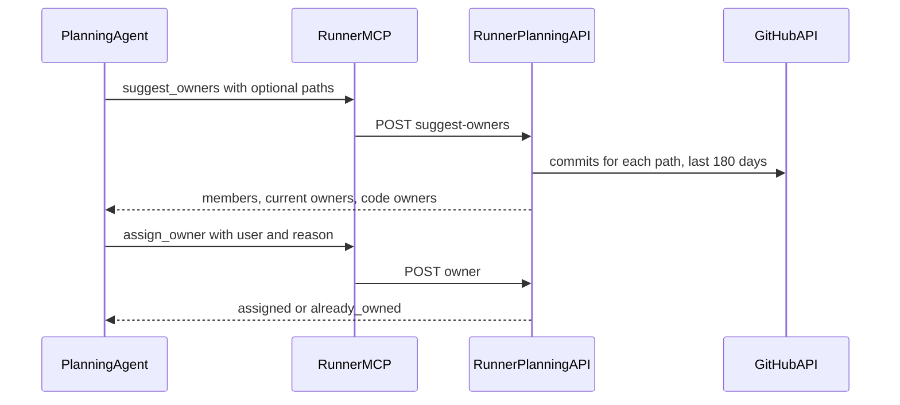

# Task owner tools for planning

## Summary

Exceptions, production problems, and CVE security problems often arrive at
night. A task without an owner stays stale. Each team has its own rules for who
reviews and who owns a task.

The planning agent gets two tools. One tool finds the people who can review or
own a task. The other tool sets the task owner. The team writes its rules in
the **Additional instructions** of the planning settings. SuperPlane does not
add an owner rule to the planning prompt.

## Goals

1. Let the agent find the best reviewer for the code that a change touches.
2. Let the agent see the members of the organization, their roles, and the
   number of open tasks that each member owns.
3. Let the agent set the task owner when the instructions ask for it.

## Non-goals

- Assign an owner when the instructions do not ask for it.
- Read rules from a repository file.
- Assign a fallback owner from the server.
- Send a new notification for the assignment.
- Replace an owner that a person set.
- Read Bitbucket code history.

## Example instructions

```text
When creating a plan, write down at the top of the plan which user is best
suited to review this task. Base it on the commit history of the files that
need to be changed. Write down their SuperPlane name and their GitHub account.
```

```text
Assign one owner while you plan this task. Always assign a person.

CVE security problems go to Mijat.
Sentry exceptions in payments go to Pedro.
A production problem in the web app goes to the person who last changed that
screen.

Everything else goes to the person with the fewest assigned tasks on the board.
```

## How it works



The planning protocol names the two tools. It tells the agent to use them only
when the task or the instructions ask for a reviewer or an owner.

## Tools

Both tools use the planning session token. Each tool can only read or change
the task of that session.

### `suggest_owners`

Input: `paths`, optional, at most 10 repository paths.

Output:

| Field | Content |
| --- | --- |
| `paths` | The cleaned paths. Paths that leave the repository are removed. |
| `current_owners` | The owners of the task now. |
| `members` | Each human member: `user_id`, `name`, `email`, `github_login`, `roles`, and `open_tasks`. Sorted by `open_tasks`, fewest first. |
| `code_owners` | Members who changed the paths, ranked by recent commits. Empty without paths. |
| `history_note` | Set when SuperPlane could not read the code history. |

`github_login` is empty when the member has no GitHub account in **Settings >
Account > Associated accounts**. Only members with a GitHub account can appear
in `code_owners`.

`roles` holds the display names that the Members page shows, for example
Owner, Admin, Maintainer, or Operator.

`open_tasks` counts the draft and open tasks that the member owns in the same
workspace.

### `assign_owner`

Input: `user` (a `user_id` or a GitHub login from `suggest_owners`) and
`reason` (one sentence).

The tool sets the owner only when the task has no owner. It returns
`already_owned` and changes nothing when the task has an owner. The timeline
shows "SuperPlane assigned" with the reason.

## Ranking

For each path, the server lists commits from the last 180 days with the GitHub
integration of the factory. The server:

- skips bot authors and commits that the SuperPlane agent co-authored;
- matches each author to a member by GitHub user ID, and uses the login only
  when the ID is unknown;
- scores each author by commit count, with more weight on recent commits;
- breaks ties by the fewest open tasks.

## Safety

- The server only accepts human members of the organization, so a bad pick
  cannot assign a stranger.
- `assign_owner` does nothing when the task has an owner.
- The agent writes the reason while it reads untrusted text. The server keeps
  one line of plain text, removes links, and limits it to 280 characters.
- The runner token outlives the session. The owner routes reject an ended
  session and a closed or archived task.
- The manual owner update and `assign_owner` lock the task row, so they cannot
  add two owners at the same time.

## Endpoints

| Route | Purpose |
| --- | --- |
| `POST /api/v1/runner/planning-sessions/suggest-owners` | List members and rank code owners for the session task. |
| `POST /api/v1/runner/planning-sessions/owner` | Set the owner of the session task. |

## Deployment

No new environment variables. The tools use the existing GitHub integration of
the factory and the existing planning session token.
